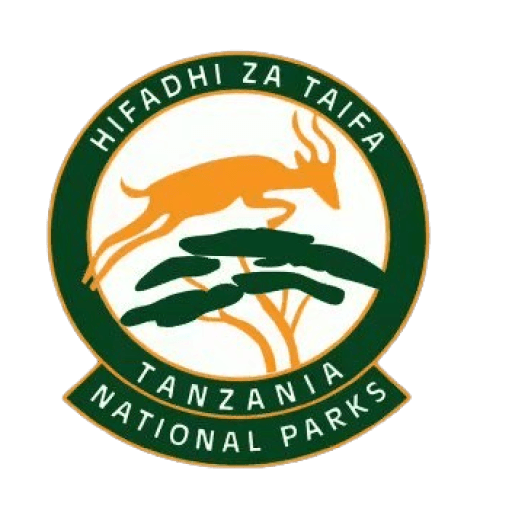
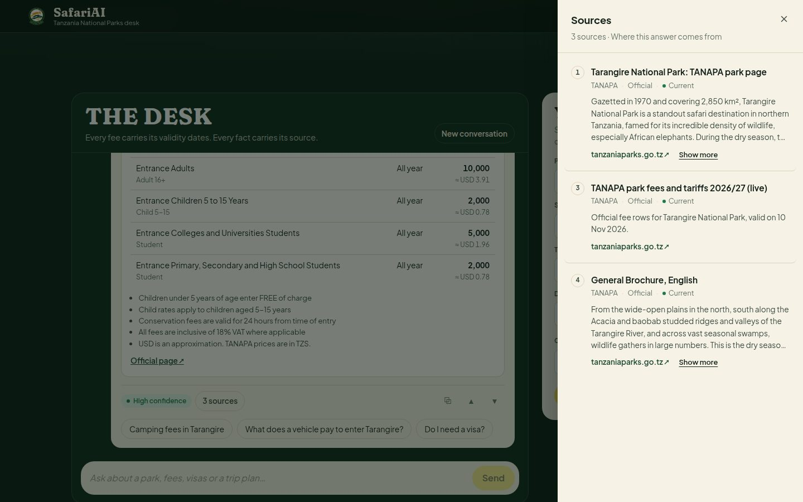

<div align="center">



# SafariAI Tanzania

A helper for anyone planning a visit to Tanzania's national parks.

**[Try it live at safari-ai.pages.dev](https://safari-ai.pages.dev/)**

</div>

You ask a question, like *"How much is it to enter Serengeti?"* or *"Where can I see chimpanzees?"*, and SafariAI answers in English or Kiswahili. Every answer shows where its information came from, so you can check it yourself.

[](https://safari-ai.pages.dev/)

## What it helps with

- Park entry fees for your travel dates, and what your whole group will pay
- Picking a park for the animals and scenery you want to see
- Visa rules for your passport
- Activities, places to stay and park contacts
- A trip summary you can download as a PDF

## Where the information comes from

All answers come from official sources:

- **TANAPA** (Tanzania National Parks Authority): park fees, park pages, activities, accommodation and their published guides
- **Tanzania Immigration**: the visa list for each country

SafariAI checks TANAPA for new information twice a day. It is an independent project, not run by TANAPA or the government, so please confirm fees with the park authority before you pay or travel.

## How it works

SafariAI is a **RAG agent**. RAG stands for *retrieval-augmented generation*, which means it looks up the facts first and only then writes the answer.

When you ask something, SafariAI searches the official fee tables, park pages and documents for what applies to you. Then an AI model (DeepSeek) writes the answer using only what was found. Before you see it, every price is checked against the official data and the sources are attached. If the official information doesn't cover your question, SafariAI tells you so and points you to the right office instead of guessing.

Think of a park desk officer who opens the official rate book before quoting you a price.

### Why hybrid RAG

A plain RAG system embeds the question, pulls the nearest text chunks from a vector store and hands them to the model. That breaks down here. Fees are numbers in a table, not prose, and a vector search alone can't tell an expired tariff from the current one. So SafariAI combines structured lookups with two kinds of search, and ranks the results with rules about authority and dates.

- **Structured tools.** Fees, visa rules and park facts are exact lookups on records synced from TANAPA's API, filtered by the travel date. Trip totals come from a calculator tool. DeepSeek reaches all of these through function calling and never does the arithmetic itself.
- **Chunking.** Documents (PDFs, park pages, FAQs) are split into chunks of about 900 characters with a 140-character overlap. Each chunk keeps its document's authority, status and validity dates.
- **BM25 keyword search.** Scores chunks on exact term matches (k1 = 1.5, b = 0.75), which catches names and specific words like "drone", "Gombe" or "camping fee".
- **Vector search.** Every chunk has a 384-dimension vector, compared with the question by cosine similarity. The vectors are hashed from words and word pairs, which is fast and needs no model download. A sentence-transformer can replace them without changing the 384-dimension `pgvector` column.
- **Reranking and fusion.** The scores are blended, with weight on authority and freshness so official, in-force documents come first:

  ```text
  score = 0.34 × vector + 0.24 × BM25 + 0.18 × rerank + 0.14 × authority + 0.10 × freshness
  ```

  A superseded document drops to a quarter of its score when a current one exists, and at most two chunks per document reach the model, so one long PDF can't crowd out the rest.
- **Grounded generation.** DeepSeek writes from the tool results only, citing each source as [n]. A grounding check rejects any figure that no tool returned and any answer that cites nothing. The draft is rewritten once, then replaced by a deterministic composer that uses the same tools.



## Where it runs

| Part | Service |
|---|---|
| The website | Cloudflare Pages |
| The assistant behind it | Render |
| The database | Supabase |
| The AI model | DeepSeek |

Everything runs on free plans while SafariAI is being tested.

## About this project

SafariAI is not a commercial product. It's a learning project, built to explore how an AI assistant can give answers people can actually trust.

It's free to use. If it helps you, whether you're a visitor, a park, a tour operator or someone building solutions for the parks, you're welcome to use it and learn from it.

## For developers

Installation, settings and deployment are in the [technical guide](SAFARI-AI/README.md). For a closer look at how answers are put together, read [how it works](SAFARI-AI/docs/how-it-works.md).

---

<div align="center">

Made with ❤️ by [aselvicta](https://github.com/aselvicta) for Tanzania's national parks and everyone on their way to see them.

</div>
